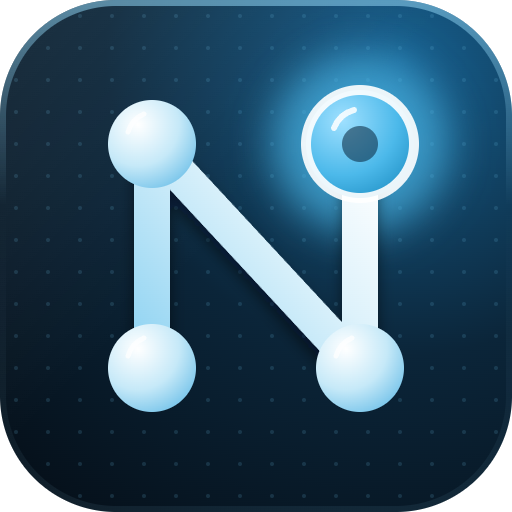
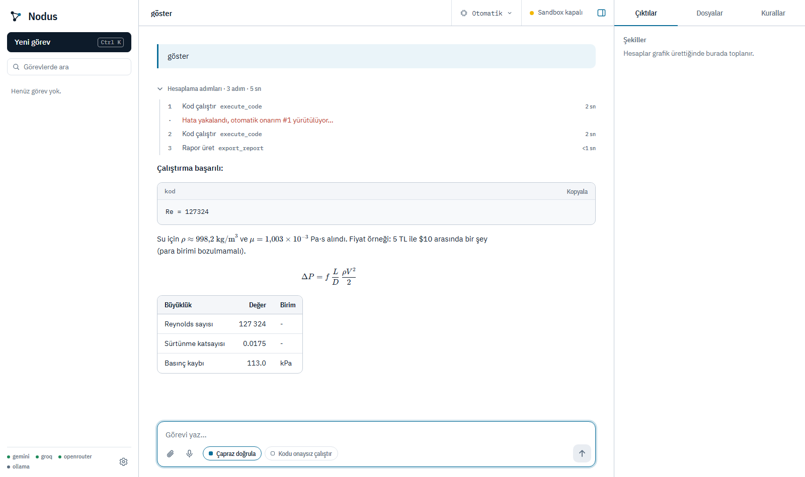
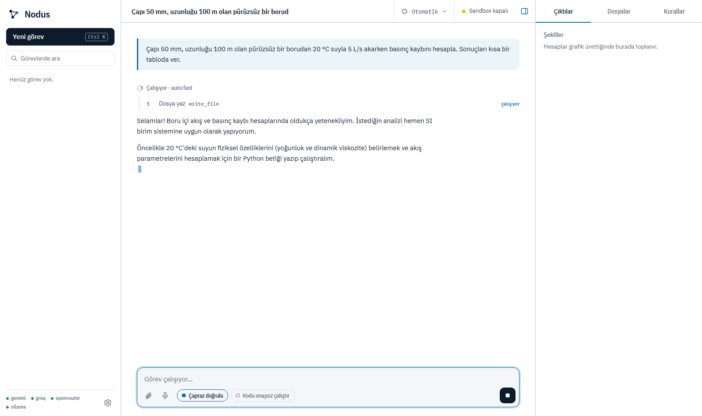
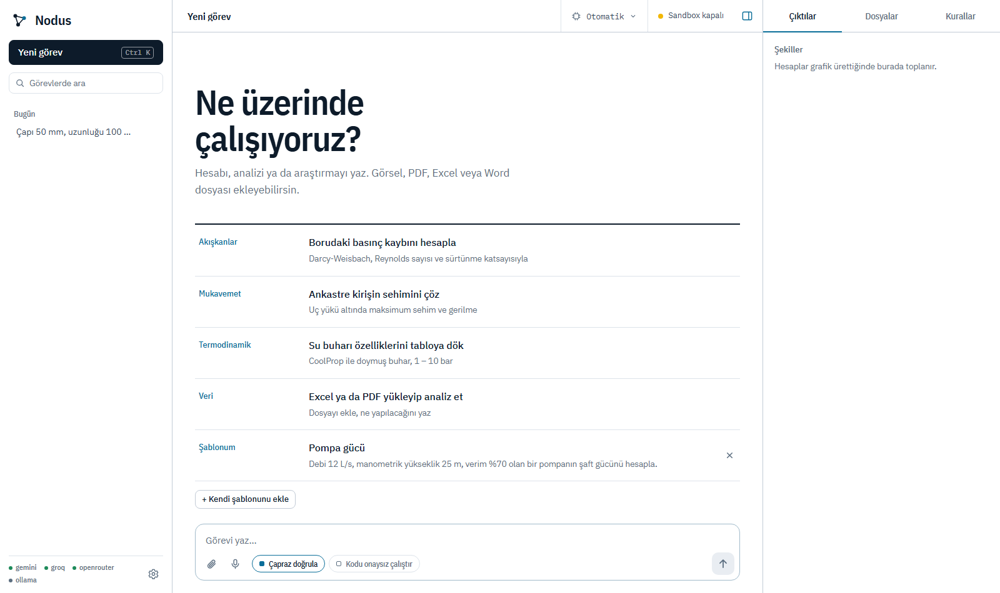

<p align="center"></p>

# Nodus

**Mühendislik hesaplarını, dosya ve araştırma işlerini kendi başına yürüten, yerel çalışan otonom yapay zeka ajanı.**
*An autonomous, locally-run AI agent for engineering calculations, file work and research.*

> **Sürüm: v1.6.2-beta.** Günlük kullanıma yakın ama henüz geniş çapta denenmedi. Bilinen sınırlar için [Sınırlar](#sınırlar-ve-beta-notları) bölümüne bak.



## Nodus ne yapar?

Bir görevi Türkçe yazarsın; Nodus planlar, doğru aracı seçer, hesabı yapar ve sonucu birimleriyle, denklem ve tablolarla sunar. Kod çalıştırma, dosya silme gibi riskli her adımda **önce senden onay ister**.

Örnek görevler:

- *"Çapı 50 mm, uzunluğu 100 m olan pürüzsüz borudan 20 °C suyla 5 L/s akarken basınç kaybını hesapla."*
- *"Boyu 2 m, 40×40 mm çelik kare profilli ankastre kirişin ucuna 500 N yük gelirse sehimi ve gerilmeyi bul."*
- *"Doymuş su buharının 1–10 bar arasındaki entalpi ve entropi tablosunu ver."*
- Bir Excel/PDF/Word/CSV yükle: *"Bu verideki trendi analiz et."*
- Bir teknik çizim görseli yükle: *"Şekildeki kirişin maksimum sehimini hesapla."*

## Öne çıkanlar

| | |
|---|---|
| **Hazır, doğrulanmış hesaplar** | Boru basınç kaybı (Darcy-Weisbach + Colebrook-White), kiriş sehimi ve gerilmesi, doymuş buhar tablosu, pompa/fan gücü, mil burulması, cıvata kontrolü ve çok katmanlı duvardan ısı geçişi. Model formülü kafasından yazmaz; `eng_calc` aracı ile birim testli fonksiyonları çağırır. |
| **Çoklu model yönlendirici** | Gemini, Groq ve OpenRouter arasında görev türüne göre seçim yapar; kota dolunca ya da sağlayıcı yanıt vermezse otomatik yedeğe geçer. |
| **Çapraz doğrulama** | Ağır görevlerde cevap, farklı bir sağlayıcının modeline denetlettirilir. Model itiraz ederse hesap, itiraz notuyla bir kez yeniden yaptırılır. |
| **Onay kapısı** | Kod çalıştırma, kabuk komutu, dosya silme, kalıcı hafıza yazımı onay ister. Onay ekranında *gerçekte çalışacak* kod (başvurulan dosyalar dahil) gösterilir. |
| **Durdur düğmesi** | Çalışan görevi her an durdurur; çalışan kod/komut süreci de öldürülür. |
| **Adım kaydı** | Her görevin araç adımları ve süreleri sohbetle birlikte kaydedilir. |
| **Rapor** | Cevabı tek tıkla Word (.docx) veya PDF rapora dönüştürür (şekiller gömülü). |
| **Dosya ve görsel girişi** | Sürükle-bırak, yapıştırma ya da düğme ile; PDF, Excel, Word, CSV, PNG/JPG. Sesli komut (Groq anahtarı varsa). |
| **Yerel ve gizli** | Arayüz yalnızca `127.0.0.1`'de çalışır. Sohbetler ve notlar diskinde kalır. |
| **Açık/koyu tema** | Mühendislik çizim kâğıdı (mavi kopya) esinli, tam ekran arayüz; telefon ve tablete uyumlu. |



## Kurulum

### Tek satırla kurulum (önerilen)

Hiçbir şey kurman gerekmez; Python'u da Nodus kendisi getirir.

**macOS / Linux** — Terminal'i aç, yapıştır, Enter:

```bash
curl -fsSL https://raw.githubusercontent.com/mbmakes/Nodus/master/install.sh | bash
```

macOS'ta kurulum sonunda `~/Applications/Nodus.app` oluşur: Launchpad'den veya Spotlight'tan (⌘Space → Nodus) açılır, Dock'a sürüklenebilir. Uygulama bu Mac'te üretildiği için Gatekeeper uyarısı çıkmaz. Zaten kuruluysa aynı komutu yeniden çalıştırmak simgeyi ekler.

**Windows** — PowerShell'i aç, yapıştır, Enter:

```powershell
irm https://raw.githubusercontent.com/mbmakes/Nodus/master/install.ps1 | iex
```

Bu komut son sürümü `~/Nodus` klasörüne (Windows: `%USERPROFILE%\Nodus`) indirir; **Python 3.12 yoksa klasörün içine, yönetici izni istemeden kurar** (taşınabilir, [uv](https://github.com/astral-sh/uv) ile; indirilen dosyanın SHA-256 özeti doğrulanır), kütüphaneleri kurar ve Nodus'u açar. İlk açılışta bir **anahtar penceresi** gelir: ücretsiz [Gemini anahtarını](https://aistudio.google.com/apikey) yapıştırırsın, doğrulanır ve kaydedilir; `.env` dosyasını elle düzenlemen gerekmez. Sonraki açılışlar için klasördeki `run_nodus.bat` (Windows) ya da `bash run_nodus.sh` (macOS/Linux) yeter. Önce betiği okumak istersen: [`install.sh`](install.sh), [`install.ps1`](install.ps1).

### Elle kurulum

Gereksinimler: **Python 3.12** (Windows'ta yoksa başlatıcı kendisi kurar) ve en az bir sağlayıcı anahtarı (ücretsiz katmanlar yeterli). Anahtarı `.env` dosyasına yazmak yerine ilk açılışta çıkan pencereye de yapıştırabilirsin.

**Windows**

```bash
git clone https://github.com/mbmakes/Nodus.git
cd Nodus
copy .env.example .env      # ardından .env içine anahtarlarını yaz
run_nodus.bat
```

**macOS** *(GitHub'ın macOS sunucusunda otomatik testlerle doğrulandı; arayüz penceresi gerçek bir Mac'te elle denenmedi, bkz. [Sınırlar](#sınırlar-ve-beta-notları))*

```bash
git clone https://github.com/mbmakes/Nodus.git
cd Nodus
cp .env.example .env        # ardından .env içine anahtarlarını yaz
bash run_nodus.sh           # Terminal'den (zip indirdiysen en güvenlisi bu)
```

Python **3.12** gerekir (Mac'in kendi `python3`'ü genelde eski, Homebrew'unki çok yeni olabilir): `brew install python@3.12`. Başlatıcı `python3.12`'yi kendisi bulur; farklı bir Python kullanmak için `PYTHON=python3.12 bash run_nodus.sh`. İlk açılışta `.venv` oluşturulur ve kütüphaneler oraya kurulur (ilk seferde birkaç dakika sürebilir). Zip'ten çıkardıysan ve macOS "doğrulanamadı" derse `bash run_nodus.sh` kullan; `run_nodus.command`'a çift tıklamak için önce sağ tıklayıp "Aç" demen gerekebilir. Sesli komut için tarayıcı mikrofon izni, ekran görüntüsü aracı için macOS "Ekran Kaydı" izni gerekebilir.

Başlatıcılar eksik kütüphaneleri otomatik kurar, sunucuyu başlatır ve arayüzü Edge/Chrome'da uygulama penceresi olarak açar (`http://127.0.0.1:8765`); bulamazsa varsayılan tarayıcıyı kullanır.

Anahtarlar (`.env`) — en az biri gerekli:

| Değişken | Nereden |
|---|---|
| `GEMINI_API_KEY` | Google AI Studio |
| `GROQ_API_KEY` | console.groq.com (sesli komut için de gerekir) |
| `OPENROUTER_API_KEY` | openrouter.ai |

İsteğe bağlı ortam değişkenleri: `NODUS_PORT` (varsayılan 8765), `NODUS_NO_WINDOW=1` (pencere açma), `NODUS_WORKSPACE` (çalışma alanı klasörü), `NODUS_MEMORY_DIR` (bellek klasörü), `NODUS_SANDBOX=docker` (kodu Docker içinde çalıştır).

Komut satırı: `python main.py "görev metni"` · Eski Streamlit arayüzü: `run_nodus_classic.bat`.

## Güncelleme

Nodus açılınca (arka planda, en fazla yarım saatte bir) GitHub'daki en son sürüme bakar. Yeni sürüm varsa **sürüm numarası ve güncelleme notlarıyla** bir pencere açılır:

> *Nodus 1.1-beta yayınlandı. Şimdi güncellemek ister misin?* **[Şimdi güncelle]** **[Sonra]**

"Şimdi güncelle" dersen tek tıkla indirilir, uygulanır ve Nodus kendini yeniden başlatır; sayfa otomatik yenilenir. Elle denetlemek için: **Ayarlar → Sürüm → Güncellemeleri denetle**.

- **Verilerin korunur:** `.env` (anahtarların), `memory/` (görevler, notlar, kurallar), `workspace/`, `custom_tools/` ve `core_vault/` dokunulmaz.
- **Geri alma yedeği:** Değişen dosyaların eski halleri `.update_backup/` klasörüne kopyalanır; bir adım başarısız olursa her şey otomatik geri alınır.
- **Git ile kurduysan** güncelleme `git` ile yapılır (yalnızca fast-forward; dosyalarda yerel değişiklik varsa dokunmaz ve seni uyarır). Zip olarak indirdiysen sürüm arşivi indirilip üstüne yazılır.
- **Gizlilik ve güvenlik:** Denetim GitHub'a bir istek yapar (GitHub IP adresini görür, başka veri gönderilmez). Yalnızca `github.com/mbmakes/Nodus` sürümleri kabul edilir; arşiv yazılmadan önce doğrulanır (güvensiz yollar reddedilir). Arşivin dijital imzası yoktur; güven, GitHub'ın HTTPS bağlantısı ve bu depoya dayanır.
- **Kapatmak için:** `.env` ya da ortam değişkeni olarak `NODUS_NO_UPDATE_CHECK=1`.
- Çalışan bir görev varken güncelleme başlamaz.

> v1.0-beta bu özelliği içermez; ondan 1.1'e bir kez elle geçmen gerekir (`git pull` ya da yeni zip). Sonraki sürümler uygulamadan güncellenir.

## Nasıl çalışır?

```
Tarayıcı (web/)  ──SSE──►  server.py (Starlette)
                              │
                       orchestrator.py   ReAct döngüsü, onay politikası, iptal
                              │
              ┌───────────────┼────────────────┐
         agent_core.py    providers.py       tools.py
         sistem istemi    model yönlendirici  araç kayıt defteri,
         araç çağrıları   kota/sağlık         workspace kafesi, sandbox
                                                  │
                                              engcalc.py  doğrulanmış hesaplar
```

- **ReAct döngüsü:** model bir araç çağırır, sonucu görür, devam eder; en fazla 12 adım. Aynı eylem 3 kez tekrarlanırsa döngü kesilir.
- **Araçlar:** `eng_calc`, `execute_code`, `solve_math`, `web_search`, `fetch_url`, `browse_url`, `read_document`, `read_file`/`write_file`/`apply_patch`, `export_report`, `update_plan`, `remember`/`recall` ve dahası.
- **Hafıza:** kalıcı kurallar ("SI birim sistemi kullan"), notlar (SQLite) ve sohbet geçmişi yerel `memory/` klasöründe.



## Güvenlik modeli

- **Workspace kafesi:** Tüm dosya işlemleri çalışma alanında kalır; `..`, sembolik link ve mutlak yol kaçışları reddedilir.
- **Onay politikası:** Kod/komut çalıştırma ve silme her zaman onay ister. İnternetten ya da belgeden içerik okunduktan sonra, "otomatik çalıştır" açık olsa bile onay istenir (prompt injection riskine karşı).
- **Yerel sunucu:** Yalnızca `127.0.0.1`/`localhost` Host başlığı, değiştirici isteklerde özel başlık + aynı origin, sıkı CSP. SVG/HTML hiçbir zaman satır içi sunulmaz.
- **Alt süreçler** API anahtarları olmadan, çalışma alanı içinde, zaman aşımıyla çalışır.

> ⚠️ **Docker sandbox kapalıyken** onaylanan kod senin makinende, kullanıcı hesabının yetkileriyle çalışır. Kodu okumadan onaylama. Güçlü izolasyon için Docker kur ve `.env`'e `NODUS_SANDBOX=docker` ekle (`sandbox/Dockerfile`).

## Testler

```bash
python -m pytest tests -q -p no:cacheprovider      # 68 test
```

Ajan/araç davranışı, güvenlik politikası, sunucu uçları (gerçek uvicorn + sahte model), durdurma ve süreç öldürme, rapor, arama ve hesap doğrulukları kapsanır.

## Sınırlar ve beta notları

- **Windows**'ta elle ve otomatik olarak denendi. **macOS:** GitHub Actions'ta (macos-latest) tüm testler ve başlatıcının sunucuyu açma testi geçiyor; ancak arayüz penceresi, mikrofon ve ekran görüntüsü izinleri gerçek bir Mac'te elle denenmedi. Sorun yaşarsan Issues'a yaz.
- Kod/komut çalıştırma, Docker kurulmadıkça işletim sistemi düzeyinde izole değildir.
- Model hesapları hatalı olabilir; hazır hesaplar (`eng_calc`) ve çapraz doğrulama bunu azaltır ama ortadan kaldırmaz. Sonuçları kritik işlerde bağımsız doğrula.
- Ücretsiz sağlayıcı katmanlarında kota dolabilir; Nodus yedeğe geçer ama yanıt süresi uzayabilir.
- Sesli komut Groq'a ses gönderir.
- Henüz CI yok; testler elle çalıştırılır.

## Yol haritası

- Daha fazla doğrulanmış hesap (ısı transferi, pompa/fan seçimi, mil ve cıvata hesapları)
- Docker sandbox'ı varsayılan yapma ve kurulum sihirbazı
- Cevap içi grafikler için etkileşimli önizleme
- macOS desteğini gerçek donanımda doğrulama, Linux başlatıcısı
- CI (GitHub Actions: Windows, macOS, Linux)

## Lisans

[MIT](LICENSE) © 2026 mbmakes

İstediğin gibi kullanabilir, değiştirebilir ve paylaşabilirsin. Tek ricam: işine yaradıysa bir teşekkür (ya da depoya ⭐) yeter. Lisans metnindeki telif satırını koruman yeterli.
